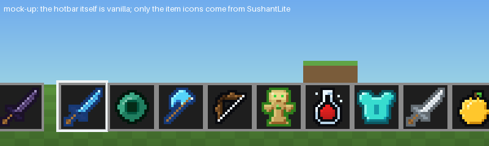
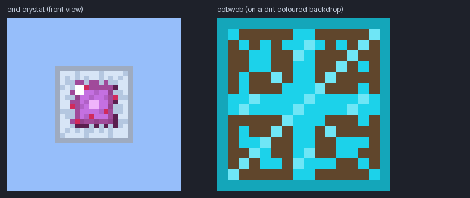

<p align="center">
  
</p>

<h1 align="center">SushantLite</h1>

<p align="center">
  A <b>barebones 16x PvP overlay</b> for Minecraft: Java Edition.<br>
  Blue diamond &amp; violet netherite swords · cyan cobwebs · framed end crystals · low fire · everything else stays vanilla.
</p>

<p align="center">
  <b>Supports 1.21.11 · 26.1.x · 26.2 · 26.3</b> &nbsp;(one zip, all versions)
</p>

<p align="center">
  
</p>

> **About the previews.** They are mock-ups composed from this pack's own files (a plain grey hotbar, flat paper dolls, an approximated fire overlay). They are a design aid, not screenshots from the game. The real hotbar, hearts and every other part of the interface are **vanilla**: this pack does not touch the HUD.

---

## What it changes

The pack is deliberately small (44 files, 24 KiB). It changes the things that matter in a PvP fight and leaves the rest of the game exactly as Mojang made it.

| | |
|---|---|
| ⚔️ **Swords** | All six materials. **Diamond is blue**, **netherite a dusty violet**, **gold orange-red**, plus wooden, stone and iron. A symmetric three-stripe blade, a straight guard, and an outline in a darker shade of the material instead of black. |
| ⛏️ **Diamond tools** | Pickaxe, axe, shovel and hoe with bright cyan heads and blue edges. |
| 🪖 **Diamond & netherite armor** | Worn armor (both layers) and the eight inventory icons: bright aqua diamond, near-black violet netherite. |
| 🎯 **PvP items** | Bow (and its three pull stages), ender pearl (a dark ring), golden apple, apple, totem of undying (tan idol, green eyes and chest gem, green outline) and the three potion bottles. |
| 🕸️ **Cobweb** | A cyan frame round a chunky cyan web: you see a trap from across the room. |
| 🔶 **Low fire** | Amber-orange flames with pale hot cores that only lick the bottom edge of the screen (about 7-30 % of its height from FOV 70 to 110; vanilla covers two thirds or more). World fire uses the same low flame. |
| 💎 **End crystal** | Pale steel-blue glass frames with a jagged inner edge round a pink-violet core. |
| ☁️ **Clouds, crits** | Sparser clouds and a tiny critical-hit spark. |

**Left vanilla on purpose:** the whole HUD (hotbar, hearts, food, armor bar, XP bar, crosshair), tools of other materials, food, shield, crossbow, trident, elytra, arrows, water, rain and snow, sounds, particles, models and sizes in hand. Because the pack only overrides a few textures it also stacks cleanly on top of any other resource pack.

<p align="center">
  
</p>

<details>
<summary><b>More previews</b> (worn armor, end crystal and cobweb, low fire at several FOVs)</summary>
<br>

<br><br>

<br><br>

</details>

---

## Install

1. Get `SushantLite-vX.Y.Z.zip` from the repository's **Releases** page (pushing a `vX.Y.Z` tag makes CI build and publish it), or build it yourself in one command: `pip install -r requirements.txt && python tools/build.py` writes it to `dist/` ([details](#build-from-source)).
2. In Minecraft: **Options → Resource Packs → Open Pack Folder**, drop the zip in, then move **SushantLite** to the selected side.
3. Optional: use `SushantLite-vX.Y.Z-static.zip` instead if you want the fire frozen to a single frame (slightly fewer texture updates on very low-end PCs).

Don't unzip it - Minecraft reads the zip directly. Because SushantLite is an overlay, you can keep another pack below it in the list.

### Compatibility

One pack covers all of these. The numbers are the resource-pack format of each version, read from each version's own `version.json`.

| Minecraft | Pack format | Checked |
|---|---|---|
| 1.21.11 | 75 | ✅ structurally validated |
| 26.1, 26.1.1, 26.1.2 | 84 | ✅ structurally validated (26.1.2) |
| 26.2 | 88 | ✅ structurally validated |
| 26.3 | 97.1 | ✅ structurally validated |

"Structurally validated" means every file is checked against that version's real asset list (paths, texture sizes, animation strips). It does **not** replace loading the pack in the game: see [docs/COMPATIBILITY.md](docs/COMPATIBILITY.md) for what is and isn't verified, and [docs/TESTING.md](docs/TESTING.md) for an in-game checklist (the pack has not been played by its author yet). Every file in the barebones pack has the same path and size on all four versions, so it needs no per-version overlay.

The pack declares `min_format: 75` / `max_format: 97`. On a newer game version Minecraft will show a "made for an older version" notice; bump `MAX_FORMAT` in `tools/sushantlite/config.py`, re-run the validator, and rebuild.

---

## Details

<details>
<summary><b>Swords and tools</b></summary>

| Material | Blade ramp (dark / mid / light / glint) |
|---|---|
| Diamond sword | `#2358b4` / `#3f98dc` / `#5ad8fb` / `#c4f7ff`, outline `#173975` |
| Netherite sword | `#2a1a3e` / `#4a3566` / `#6d5a90` / `#a090c0`, outline `#1b1128` |
| Golden sword | `#8e3a12` / `#c25721` / `#e8803a` / `#ffc890` |
| Diamond tool heads | `#2a74c8` / `#55d4fa` / `#98f4ff` / `#e0fdff` |

The blade is three pixels wide along the diagonal: light flanks round a mid centre line, a pale glint on the tip and on every other cell of the upper flank. The ramps for the diamond and netherite swords were measured on screenshots of the pack this look follows; the shapes are drawn from scratch.
</details>

<details>
<summary><b>Armor, pearl, totem, potions</b></summary>

| Texture | Notes |
|---|---|
| Worn diamond / netherite armor (`entity/equipment/humanoid/*`, `humanoid_leggings/*`) | The standard humanoid UV layout; coverage rules reproduce the vanilla silhouettes. Clean bevelled plate, no decoration. Netherite is dark grey-violet (`#312836` mid). |
| Armor icons | The same colours, with a darker outline. |
| Ender pearl | Black-green core ringed in dark teal, light-teal glint. |
| Totem of undying | Tan body, pale-gold face, bright green eyes, a small green chest gem (as in vanilla), green outline. |
| Potions | The bottle, splash and lingering shapes share one liquid mask with `potion_overlay`, so the tint lines up. |
</details>

<details>
<summary><b>World and effects</b></summary>

| Feature | How |
|---|---|
| Low fire | New `fire_0` and `fire_1` animations (32 frames each, half a period out of step) whose amber flame tips sit around row 8 of the sprite instead of row 2, with a pale hot core in each tongue. The first-person overlay only samples the middle of the frame, so on average only the bottom ~7 % (FOV 70), ~20 % (FOV 90) or ~29 % (FOV 110) of the screen is covered, the tallest tongues reaching 30-40 %. |
| Cobweb | A 1-px cyan frame (`#14a6ba`) round eight spokes, one ragged ring and a hub in bright cyan (`#1cd2ea`): 62 % of the texture is opaque. |
| End crystal | Pale steel-blue glass (`#9eabc0` edge, `#d7e5f6` inside) two to three pixels thick with a jagged inner edge, a pink-violet core with crimson speckles, and a plain dark-grey base slab (only drawn for crystals summoned with `ShowBottom`). |
| Clouds | About 23 % coverage (vanilla ~28 %). |
| Critical hit | A small white spark. |
</details>

---

## Profiles

The generators know how to draw far more than the barebones pack ships. A **profile** decides which of those files are written:

| Profile | Contents |
|---|---|
| `barebones` (default) | The 44 files above. This is what the zips contain. |
| `full` | Everything the generators can draw: a custom HUD, every tool and armor material, foods, crossbow, shield, trident, elytra, arrows, XP orbs, water, rain and snow, quiet particles and sounds, smaller shield and totem pop. This is the scope of the 0.1-0.3 releases. |

```bash
python tools/generate.py --profile full      # writes the full pack into SushantLite/ (do not commit it)
python tools/generate.py                     # back to the barebones pack
```

The exact file list of the barebones pack is `BAREBONES` in `tools/sushantlite/config.py`; a test fails if the pack ships anything else.

---

## Build from source

Every texture is produced by code (Python + Pillow). Nothing is copied from Mojang or from other packs.

```bash
pip install -r requirements.txt        # Pillow
python tools/generate.py               # (re)generate SushantLite/ from the code
python tools/validate.py               # check it against 1.21.11 / 26.1.2 / 26.2 / 26.3
python tools/build.py                  # dist/SushantLite-vX.Y.Z.zip (+ -static.zip)
python tools/preview.py                # refresh docs/previews/*.png
python -m unittest discover -s tools/tests   # generator regression tests
```

Handy options: `generate.py --only items`, `generate.py --check` (CI: is the committed pack in sync?), `generate.py --profile full`, `validate.py -v --strict`, `build.py --version 0.4.1`.

### Make it yours

| Want to change... | Edit |
|---|---|
| Sword / tool colours | `TOOL_HEADS`, `TOOL_FILL`, `TOOL_TRIM` in `tools/sushantlite/theme.py` |
| Armor colours | `MATERIALS`, `TRIM` in the same file |
| How low the fire is, and its colours | `FIRE_TIP_ROW`, `_FIRE_RAMP`, `_FIRE_CORE` in `tools/sushantlite/gen/effects.py` |
| The cobweb pattern | `cobweb_sprite()` in the same file |
| A sword's silhouette | the ASCII masks at the top of `tools/sushantlite/gen/items.py` |
| What the pack ships | `BAREBONES` in `tools/sushantlite/config.py` |
| Supported versions | `MIN_FORMAT` / `MAX_FORMAT` in `tools/sushantlite/config.py` |

Prefer to paint a texture by hand? Edit the PNG in `SushantLite/` and list its pack-relative path in `tools/locked.txt` (create the file) - the generator will then leave it alone.

### Project layout

```
SushantLite/                 the resource pack (this is what gets zipped)
├── pack.mcmeta  pack.png
└── assets/minecraft/...     the 44 files above (no overlays are needed: every path is identical on all versions)
tools/
├── generate.py              code -> pack
├── validate.py              pack -> checked against every supported version
├── build.py                 pack -> reproducible zips in dist/
├── preview.py               pack -> docs/previews/*.png
├── tests/                   regression tests (python -m unittest discover -s tools/tests)
├── fetch_reference.py       refresh the vanilla path/size index (see below)
├── reference/               compact vanilla index: names + sizes only, no artwork
└── sushantlite/             theme, pixel-art toolkit (sprites, UV unwraps), generators (effects, items, armor, entities, ...)
docs/                        previews, style notes and compatibility notes
```

`tools/reference/vanilla-index.tsv.gz` (47 KiB) lists, per Minecraft version, every texture / item-model / particle / sound-event path and each PNG's size. It is built from [misode/mcmeta](https://github.com/misode/mcmeta) by `fetch_reference.py` and contains **no Mojang artwork**; it lets CI validate the pack without downloading ~800 MB per version. To add a version: `python tools/fetch_reference.py 26.4 --add`.

---

## FAQ

**Why is the HUD vanilla?**
Because the pack this look follows leaves it vanilla: its hearts, hotbar and XP bar are Mojang's. 0.1-0.3 replaced the whole HUD and the result looked nothing like the reference, so 0.4.0 stopped touching it.

**Where did the small items, clear water, thin rain, quiet sounds and the other 0.1-0.3 features go?**
They are in the `full` profile (see above) and in the 0.3.0 release. The barebones pack ships none of them.

**Is this pack a copy of another one?**
No. The look follows a PvP overlay the owner showed screenshots of (vanilla HUD, blue and violet swords, cyan cobwebs, framed end crystals, low amber fire), and a few colours were measured on those screenshots, but no file, texture or pixel of that pack is used: every texture here is drawn by the generator code. See [docs/STYLE.md](docs/STYLE.md).

**Why no full-bright, no-fog or brighter Nether?**
Those need core-shader changes (or a mod). Core shaders were reorganised between 1.21.11, 26.1, 26.2 and 26.3, I can't launch Minecraft to test them, and a broken shader can stop the game from rendering.

**Does this work on servers like DonutSMP / Hypixel?**
It is a normal client-side resource pack with no shaders and no custom models, but each server sets its own rules - check them.

---

## Roadmap

- [x] Worn armor textures, entity skins, crossbow and food icons (v0.2.0, `full` profile)
- [x] Restyle: blue / violet tools, gem-free armor (v0.3.0)
- [x] Barebones scope that matches the reference: vanilla HUD, measured colours, cyan web, framed crystal, amber low fire (v0.4.0)
- [ ] In-game screenshots to replace the mock-ups
- [ ] Netherrack, stone, cobblestone, oak planks and gravel, which the reference also adjusts (not visible enough in the screenshots to match yet)
- [ ] Container GUIs and optional shader modules

See [CHANGELOG.md](CHANGELOG.md) for what each version contains.

## Credits & legal

- The look follows the overall style of a PvP overlay on a public pack site; **none of its assets are used**. Earlier feature ideas came from the public feature lists of other PvP packs (SenpaiSpider, Living Legend, DonutSMP Essentials). All art here is original and generated by code.
- Vanilla asset names and sizes in `tools/reference/` come from [misode/mcmeta](https://github.com/misode/mcmeta).
- SushantLite is not affiliated with or endorsed by Mojang or Microsoft. "Minecraft" is a trademark of Mojang Synergies AB.
- **License: not chosen yet.** A `LICENSE` file will be added once the owner decides; until then all rights are reserved by the author.
