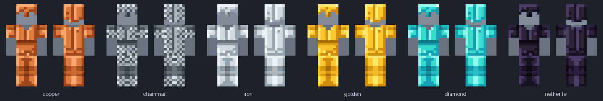
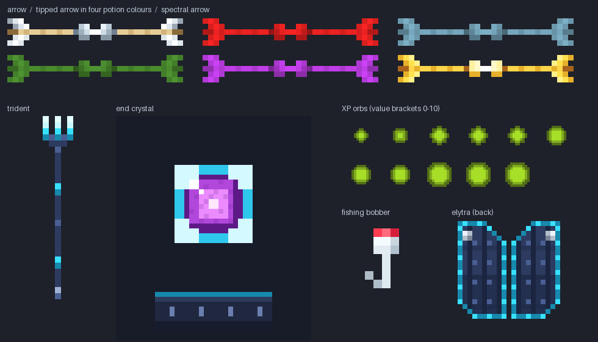

<p align="center">
  
</p>

<h1 align="center">SushantLite</h1>

<p align="center">
  A clean, lightweight <b>16x PvP / SMP resource pack</b> for Minecraft: Java Edition.<br>
  Blue diamond &amp; violet netherite tools · low orange fire · cyan-framed cobwebs &amp; end crystals · charcoal HUD · low shield · clear water · quiet particles.
</p>

<p align="center">
  <b>Supports 1.21.11 · 26.1.x · 26.2 · 26.3</b> &nbsp;(one zip, all versions)
</p>

<p align="center">
  
</p>

---

## Highlights

| | |
|---|---|
| 🔥 **Low fire** | Orange flames with white-hot cores that only lick the bottom edge of the screen (about 7-30 % of its height from FOV 70 to 110, vanilla: two thirds or more). World fire uses the same low flame. |
| 🗡️ **Bold, full-size weapons** | A chunky three-tone sword blade; **diamond tools are blue, netherite tools violet**; everything is drawn at vanilla size in first person. |
| 🛡️ **Low shield & small totem pop** | The shield sits low (0.90 instead of 1.25); the totem pop is half size. |
| 🎃 **No pumpkin overlay** | The carved-pumpkin blur is gone. |
| 💧 **Clear water** | See-through, animated water and no blue tint when you dive. |
| 🌧️ **Thin rain & snow** | Fewer, fainter streaks and flakes. |
| 💥 **Quiet particles & sounds** | No explosion bursts, fire/explosion smoke, death puffs or sweep arcs; tiny crit/hit sparks; explosions play at ~35 % volume; cave ambience off. |
| 🧰 **Full PvP item set** | Sword · axe · pickaxe · shovel · hoe · spear in all 7 materials (incl. copper), armor icons for copper / chainmail / iron / gold / diamond / netherite, mace, bow, crossbow, trident, elytra, arrow, totem (gold idol, green face), golden & enchanted apples, ender pearl, end crystal, XP bottle, 3 potion types, 17 foods. |
| 🛡️ **Wooden shield** | Oak planks, an iron rim, two straps and a round iron boss; banners still tint correctly. Uses per-version overlays (see below). |
| 🪖 **Worn armor** | What players actually see: copper, chainmail, iron, gold, diamond and netherite sets (both layers), clean bevelled plate in bold colours: bright aqua diamond, near-black violet netherite, white iron, yellow gold, grey mail. |
| 🏹 **Projectile & entity skins** | White-fletched arrows, tint-friendly tipped arrows, golden spectral arrows, a blue-steel trident, small XP orbs, a red-and-white fishing bobber, an **end crystal with a cyan frame round a magenta core** and navy elytra wings with a silver clasp. |
| 🍖 **Food, crossbow, web** | Steak, porkchop, mutton, chicken, salmon, cod (raw + cooked), golden carrot, carrot, bread, baked potato and apple; a full crossbow set (standby, 3 pull stages, arrow and firework loaded); a **cyan-framed cobweb** you can spot from across the room. |
| 🎯 **Charcoal HUD** | Neutral dark hotbar with light-grey slot frames and a white selector, gapped crosshair, redesigned hearts (all statuses + hardcore), white armor icons, round air bubbles, food, XP and horse-jump bars. |
| ✨ **Cyan glint, white sun** | Subtle cyan enchantment shimmer, a plain white sun, 8 moon phases and sparser clouds. |

**Look:** bold, vanilla-proportioned silhouettes in saturated colours. Cyan is kept for frames (cobweb, end crystal), the selector's inner line and the enchantment glint. See [docs/STYLE.md](docs/STYLE.md) for the palette and the reasoning.

<p align="center">
  
</p>

<details>
<summary><b>More previews</b> (worn armor, entities, shield, low fire at several FOVs, sky)</summary>
<br>

<br><br>

<br><br>

<br><br>

<br><br>

</details>

> **About the previews.** They are mock-ups composed from this pack's own files (HUD layout, the fire overlay's projection and additive sky blending are approximated). They are a design aid, not screenshots from the game.

---

## Install

1. Get `SushantLite-vX.Y.Z.zip`: either from the repository's **Releases** page (pushing a `vX.Y.Z` tag makes CI build and publish it), or build it yourself in one command: `pip install -r requirements.txt && python tools/build.py` writes it to `dist/` ([details](#build-from-source)).
2. In Minecraft: **Options → Resource Packs → Open Pack Folder**, drop the zip in, then move **SushantLite** to the selected side.
3. Optional: use `SushantLite-vX.Y.Z-static.zip` instead if you want fire and water frozen to a single frame (slightly fewer texture updates on very low-end PCs).

Don't unzip it - Minecraft reads the zip directly.

### Compatibility

One pack covers all of these. The numbers are the resource-pack format of each version, read from each version's own `version.json`.

| Minecraft | Pack format | Checked |
|---|---|---|
| 1.21.11 | 75 | ✅ structurally validated |
| 26.1, 26.1.1, 26.1.2 | 84 | ✅ structurally validated (26.1.2) |
| 26.2 | 88 | ✅ structurally validated |
| 26.3 | 97.1 | ✅ structurally validated |

"Structurally validated" means every file is checked against that version's real asset list (paths, texture sizes, animation strips, model parents, particle sprites, sound events). It does **not** replace loading the pack in the game: see [docs/COMPATIBILITY.md](docs/COMPATIBILITY.md) for what is and isn't verified and how version differences are handled, and [docs/TESTING.md](docs/TESTING.md) for an in-game checklist (the pack has not been played yet).

The pack declares `min_format: 75` / `max_format: 97`. On a newer game version Minecraft will show a "made for an older version" notice; bump `MAX_FORMAT` in `tools/sushantlite/config.py`, re-run the validator, and rebuild.

---

## What exactly changes

<details>
<summary><b>Effects & clarity</b></summary>

| Feature | How |
|---|---|
| Low fire | New `fire_0` and `fire_1` animations (32 frames each, half a period out of step) whose orange flame tips sit around row 8 of the sprite instead of row 2, with a small white-hot core in each tongue. The first-person overlay only samples the middle of the frame, so on average only the bottom ~7 % (FOV 70), ~20 % (FOV 90) or ~29 % (FOV 110) of the screen is covered, the tallest tongues reaching 30-40 % (vanilla covers about two thirds or more). World fire and burning mobs use the same textures, so their flames are low too. |
| No pumpkin overlay | `pumpkinblur.png` is fully transparent. |
| Clear water | `water_still` / `water_flow` redrawn at alpha ~104 (vanilla: 180), still biome-tinted; `underwater.png` transparent (the blue fog the game adds underwater is not controllable from a resource pack). |
| Rain & snow | Rain: pale streaks at ~1.5 % coverage and roughly half the opacity (vanilla: 2.5 %, deep blue). Snow: 0.3 % coverage of small flakes (vanilla: 0.8 %). |
| Particles | Explosion bursts, campfire smoke and sword-sweep arcs have blank sprites. `poof`, `smoke` and `large_smoke` are re-pointed at one blank sprite (they share vanilla's `generic_*` art with redstone dust, portals, dragon breath ..., so those stay untouched). Crit, enchanted-hit and damage-indicator sprites are drawn tiny. |
| Sounds | `ambient.cave` emptied; `entity.generic.explode` keeps vanilla samples at 35 % volume. |
| Enchant glint | Cyan, lower-intensity glint for items and armor. |
| Sky | Plain white sun, eight moon phases, ~23 % cloud coverage (vanilla ~28 %). |
</details>

<details>
<summary><b>Worn armor & entity skins</b></summary>

| Texture | Notes |
|---|---|
| Worn armor (`entity/equipment/humanoid/*`, `humanoid_leggings/*`) | Six materials x two layers, identical paths on every supported version, so they live in the shared base. The silhouettes follow the standard humanoid UV layout (helmet: top + a band round the head with nasal guard and neck guard; chestplate: torso, shoulders and upper arms with a V neck; leggings: belt + thighs; boots: soles + lower legs). **Leather (dyeable), turtle-shell and the 26.1+ baby-sized armor stay vanilla.** |
| Arrow | White fletching, light shaft, steel head: easy to follow in flight. |
| Tipped arrow | White/grey on purpose: the game multiplies the potion colour over this texture, so the whole arrow takes the potion's colour. |
| Spectral arrow | Golden. |
| Trident | Blue-steel shaft with cyan glow rings, cyan prongs. Inventory icon and 3D skin both redone (the riptide spin texture stays vanilla). |
| XP orb | Grey discs about 62 % of vanilla's diameter (the game tints them lime), same size progression. |
| Fishing bobber | Red cap, white body. |
| Elytra | Navy membrane with pleats, a glowing cyan rim and a silver clasp; the inventory icon and the broken icon match. |
| End crystal | Cyan glass frames with near-white corner caps round a bright magenta, faceted core, and a dark base slab with a cyan inlay. |
| Cobweb | A 1-px cyan frame (with brighter corners) round eight spokes and one ring: 140 opaque pixels against vanilla's 105 (+33 %), on purpose. |
| Shield (plain) | Oak planks with an iron rim, two straps and a round boss; the inside has a leather strap with an iron stud. The banner-tinted base stays a near-white face. |

The trident, tipped/spectral arrows, XP orb and bobber textures moved in 26.1, so they are written twice via the version overlays (see [docs/COMPATIBILITY.md](docs/COMPATIBILITY.md)).
</details>

<details>
<summary><b>Sizes in first person</b> (edit in <code>tools/sushantlite/gen/models.py</code>)</summary>

Only the `scale` of the first-person display transform changes, so items shrink around the same spot on screen. Since 0.3.0 only the shield and the totem pop are smaller; everything else is vanilla size, and a model whose scale equals vanilla's is not shipped at all.

| Item | Vanilla | SushantLite |
|---|---|---|
| Swords, axes, pickaxes, shovels, hoes (`item/handheld`) | 0.68 | 0.68 (vanilla) |
| Food, pearls, potions, totem, ... (`item/generated`) | 0.68 | 0.68 (vanilla) |
| Bow / crossbow | 0.68 | 0.68 (vanilla) |
| Mace | 0.90 | 0.90 (vanilla) |
| Spear (x / y) | 1.36 | 1.36 (vanilla) |
| Shield (idle and blocking) | 1.25 | **0.90** |
| Totem-of-undying pop | 1.00 | **0.50** |

Want the small items of 0.1 / 0.2 back? Set `handheld` and `generated` to 0.50 (bow 0.56, mace 0.68, spear 0.75) in `SCALES` and re-run `generate.py`.
</details>

<details>
<summary><b>HUD</b></summary>

Hotbar (neutral charcoal with a light-grey frame round every slot), selector (white ring with a cyan inner line), off-hand slots, crosshair (white, because the game draws it with an inverting blend), both attack indicators, all 47 heart sprites (normal, poisoned, withered, frozen, absorbing, hardcore, vehicle, blinking), food + hunger variants, armor, air bubbles, XP bar, horse jump bar and effect backgrounds. All keep vanilla's exact sprite sizes and slot geometry (16x16 item cells at x = 3 + 20 x slot), so item rendering lines up perfectly.
</details>

---

## Build from source

Every texture is produced by code (Python + Pillow). Nothing is copied from Mojang or from other packs.

```bash
pip install -r requirements.txt        # Pillow
python tools/generate.py               # (re)generate SushantLite/ from the code
python tools/validate.py               # check it against 1.21.11 / 26.1.2 / 26.2 / 26.3
python tools/build.py                  # dist/SushantLite-vX.Y.Z.zip (+ -static.zip)
python tools/preview.py                # refresh docs/previews/*.png
python -m unittest discover -s tools/tests   # generator regression tests
```

Handy options: `generate.py --only hud items`, `generate.py --check` (CI: is the committed pack in sync?), `validate.py -v --strict`, `build.py --version 0.2.1`.

### Make it yours

| Want to change... | Edit |
|---|---|
| Accent color / palettes | `tools/sushantlite/theme.py` (`ACCENT`, `MATERIALS`, `TOOL_HEADS` for the blue diamond / violet netherite tools, ...) |
| How big things are in hand | `SCALES` in `tools/sushantlite/gen/models.py` |
| How low the fire is | `FIRE_TIP_ROW` in `tools/sushantlite/gen/effects.py` |
| Explosion volume | `EXPLOSION_VOLUME` in `tools/sushantlite/gen/sounds.py` |
| A tool's silhouette | the ASCII masks at the top of `tools/sushantlite/gen/items.py` |
| Supported versions | `MIN_FORMAT` / `MAX_FORMAT` in `tools/sushantlite/config.py` |

Prefer to paint a texture by hand? Edit the PNG in `SushantLite/` and add its pack-relative path to `tools/locked.txt` - the generator will then leave it alone.

### Project layout

```
SushantLite/                 the resource pack (this is what gets zipped)
├── pack.mcmeta  pack.png
├── assets/minecraft/...     everything that is identical on all supported versions
├── overlay_1_21_11/         files only valid on 1.21.11 (format 75-83)  - old shield / trident / arrow / orb / bobber paths
└── overlay_26_1/            files only valid on 26.1+   (format 84-97)  - the same textures at their new paths
tools/
├── generate.py              code -> pack
├── validate.py              pack -> checked against every supported version
├── build.py                 pack -> reproducible zips in dist/
├── preview.py               pack -> docs/previews/*.png
├── tests/                   regression tests for the generators (python -m unittest discover -s tools/tests)
├── fetch_reference.py       refresh the vanilla path/size index (see below)
├── reference/               compact vanilla index: names + sizes only, no artwork
└── sushantlite/             theme, pixel-art toolkit (sprites, UV unwraps), generators (effects, hud, items, armor, entities, ...)
docs/                        previews and compatibility notes
```

`tools/reference/vanilla-index.tsv.gz` (47 KiB) lists, per Minecraft version, every texture / item-model / particle / sound-event path and each PNG's size. It is built from [misode/mcmeta](https://github.com/misode/mcmeta) by `fetch_reference.py` and contains **no Mojang artwork**; it lets CI validate the pack without downloading ~800 MB per version. To add a version: `python tools/fetch_reference.py 26.4 --add`.

---

## FAQ

**Why no full-bright, no-fog or brighter Nether?**
Those need core-shader changes (or a mod). Core shaders were reorganised between 1.21.11, 26.1, 26.2 and 26.3, I can't launch Minecraft to test them, and a broken shader can stop the game from rendering. Shader modules may come later as separate, clearly-labelled options.

**Why no "no block-break particles"?**
Those particles use the broken block's own texture; there is no particle sprite to blank.

**Does this work on servers like DonutSMP / Hypixel?**
It is a normal client-side resource pack with no shaders and no custom models that change geometry, but each server sets its own rules - check them.

**The shield / totem pop feels too small (or not small enough), or I want small swords back.**
Change `SCALES` in `models.py`, regenerate and rebuild.

**Is this pack a copy of another one?**
No. The 0.3.0 look follows the overall style of a PvP pack the owner showed screenshots of (neutral HUD, blue and violet tools, cyan outlines on cobwebs and crystals, low orange fire), but no file, texture or pixel of that pack is used: every texture here is drawn by the generator code. See [docs/STYLE.md](docs/STYLE.md).

---

## Roadmap

- [x] Worn armor textures (v0.2.0)
- [x] Trident, arrow, XP-orb, fishing-bobber and end-crystal skins (v0.2.0)
- [x] Crossbow and food icons, thin cobweb, elytra (v0.2.0)
- [x] Restyle: blue / violet tools, gem-free armor, charcoal HUD, cyan-framed cobweb and end crystal, orange low fire, wooden shield, full-size items (v0.3.0)
- [ ] Leather and turtle-shell worn textures; baby-sized armor (26.1+)
- [ ] Container GUIs (inventory, chests, crafting) in the SushantLite style
- [ ] Optional shader modules (full-bright, no-fog) once they can be tested in-game
- [ ] In-game screenshots to replace the mock-ups

See [CHANGELOG.md](CHANGELOG.md) for what each version contains.

## Credits & legal

- Feature ideas were informed by the public feature lists of other PvP packs (SenpaiSpider, Living Legend, DonutSMP Essentials). **None of their assets are used**; all art here is original and generated by code.
- Vanilla asset names and sizes in `tools/reference/` come from [misode/mcmeta](https://github.com/misode/mcmeta).
- SushantLite is not affiliated with or endorsed by Mojang or Microsoft. "Minecraft" is a trademark of Mojang Synergies AB.
- **License: not chosen yet.** A `LICENSE` file will be added once the owner decides; until then all rights are reserved by the author.
