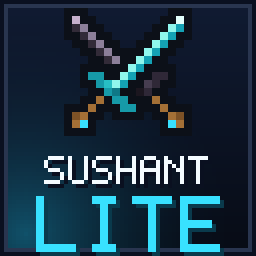
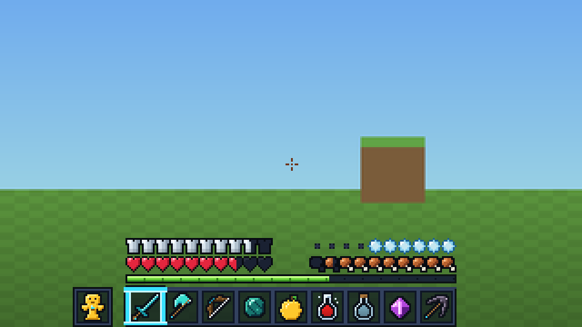
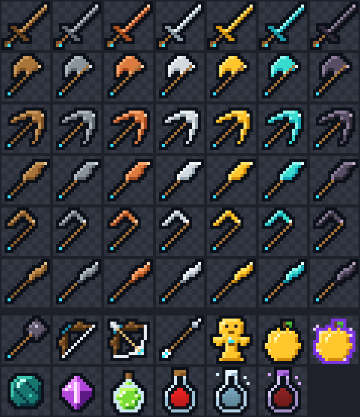
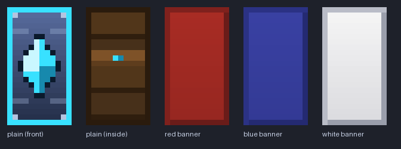
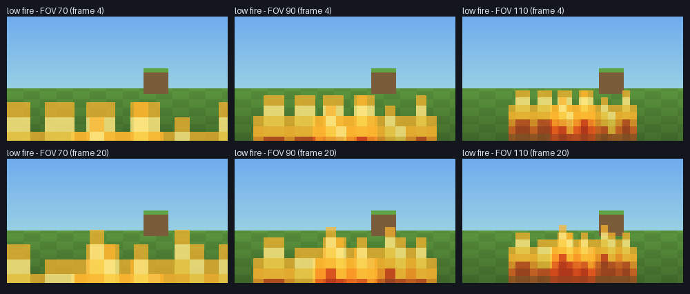
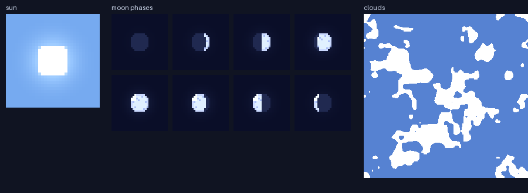

<p align="center">
  
</p>

<h1 align="center">SushantLite</h1>

<p align="center">
  A clean, lightweight <b>16x PvP / SMP resource pack</b> for Minecraft: Java Edition.<br>
  Low fire · short swords · small shield & totem · clear water · quiet particles · crisp HUD.
</p>

<p align="center">
  <b>Supports 1.21.11 · 26.1.x · 26.2 · 26.3</b> &nbsp;(one zip, all versions)
</p>

<p align="center">
  
</p>

---

## Highlights

| | |
|---|---|
| 🔥 **Low fire** | The burning overlay hugs the bottom of the screen instead of filling it, at any FOV. |
| 🗡️ **Short weapons, small items** | Swords, tools, food, pearls, potions, bow, mace and spear are drawn smaller in first person. |
| 🛡️ **Small shield & totem** | Shield sits low and small; the totem pop is half size. |
| 🎃 **No pumpkin overlay** | The carved-pumpkin blur is gone. |
| 💧 **Clear water** | See-through, animated water and no blue tint when you dive. |
| 🌧️ **Thin rain & snow** | Fewer, fainter streaks and flakes. |
| 💥 **Quiet particles & sounds** | No explosion bursts, fire/explosion smoke, death puffs or sweep arcs; tiny crit/hit sparks; explosions play at ~35 % volume; cave ambience off. |
| 🧰 **Full PvP item set** | Sword · axe · pickaxe · shovel · hoe · spear in all 7 materials (incl. copper), armor icons for copper / chainmail / iron / gold / diamond / netherite, mace, bow, arrow, totem, golden & enchanted apples, ender pearl, end crystal, XP bottle, 3 potion types. |
| 🛡️ **Custom shield skin** | Navy steel plate, cyan rim and gem emblem; banners still tint correctly. Uses per-version overlays (see below). |
| 🎯 **Clean HUD** | Glass hotbar with a cyan selector, gapped crosshair, redesigned hearts (all statuses + hardcore), food, armor, air, XP and horse-jump bars. |
| ✨ **Cyan glint, custom sky** | Subtle cyan enchantment shimmer, new sun, 8 moon phases and sparser clouds. |

Every tool and weapon carries the SushantLite signature: a tiny **cyan gem** at the end of the handle.

<p align="center">
  
</p>

<details>
<summary><b>More previews</b> (shield, low fire at several FOVs, sky)</summary>
<br>

<br><br>

<br><br>

</details>

> **About the previews.** They are mock-ups composed from this pack's own files (HUD layout, the fire overlay's projection and additive sky blending are approximated). They are a design aid, not screenshots from the game.

---

## Install

1. Download `SushantLite-vX.Y.Z.zip` from the **Releases** page (or [build it yourself](#build-from-source)).
2. In Minecraft: **Options → Resource Packs → Open Pack Folder**, drop the zip in, then move **SushantLite** to the selected side.
3. Optional: use `SushantLite-vX.Y.Z-static.zip` instead if you want fire and water frozen to a single frame (slightly fewer texture updates on very low-end PCs).

Don't unzip it - Minecraft reads the zip directly.

### Compatibility

One pack covers all of these. The numbers are the resource-pack format of each version, read from each version's own `version.json`.

| Minecraft | Pack format | Checked |
|---|---|---|
| 1.21.11 | 75 | ✅ structurally validated |
| 26.1, 26.1.1, 26.1.2 | 84 | ✅ structurally validated (26.1.2) |
| 26.2 | 88 | ✅ structurally validated |
| 26.3 | 97.1 | ✅ structurally validated |

"Structurally validated" means every file is checked against that version's real asset list (paths, texture sizes, animation strips, model parents, particle sprites, sound events). It does **not** replace loading the pack in the game: see [docs/COMPATIBILITY.md](docs/COMPATIBILITY.md) for what is and isn't verified and how version differences are handled, and [docs/TESTING.md](docs/TESTING.md) for an in-game checklist (the pack has not been played yet).

The pack declares `min_format: 75` / `max_format: 97`. On a newer game version Minecraft will show a "made for an older version" notice; bump `MAX_FORMAT` in `tools/sushantlite/config.py`, re-run the validator, and rebuild.

---

## What exactly changes

<details>
<summary><b>Effects & clarity</b></summary>

| Feature | How |
|---|---|
| Low fire | New `fire_1` animation (32 frames) whose flame tips sit around row 6-7 of the sprite instead of row 2. The first-person overlay only samples the middle of the frame, so this lowers it to roughly the bottom quarter-to-third of the screen from FOV 70 to 110 (vanilla covers about two thirds or more). World fire and burning mobs also use `fire_1` (alongside vanilla's `fire_0`), so their flames look lower on those faces too. |
| No pumpkin overlay | `pumpkinblur.png` is fully transparent. |
| Clear water | `water_still` / `water_flow` redrawn at alpha ~104 (vanilla: 180), still biome-tinted; `underwater.png` transparent (the blue fog the game adds underwater is not controllable from a resource pack). |
| Rain & snow | Rain: pale streaks at ~1.5 % coverage and roughly half the opacity (vanilla: 2.5 %, deep blue). Snow: 0.3 % coverage of small flakes (vanilla: 0.8 %). |
| Particles | Explosion bursts, campfire smoke and sword-sweep arcs have blank sprites. `poof`, `smoke` and `large_smoke` are re-pointed at one blank sprite (they share vanilla's `generic_*` art with redstone dust, portals, dragon breath ..., so those stay untouched). Crit, enchanted-hit and damage-indicator sprites are drawn tiny. |
| Sounds | `ambient.cave` emptied; `entity.generic.explode` keeps vanilla samples at 35 % volume. |
| Enchant glint | Cyan, lower-intensity glint for items and armor. |
| Sky | New sun, eight moon phases, ~23 % cloud coverage (vanilla ~28 %). |
</details>

<details>
<summary><b>Sizes in first person</b> (edit in <code>tools/sushantlite/gen/models.py</code>)</summary>

Only the `scale` of the first-person display transform changes, so items shrink around the same spot on screen.

| Item | Vanilla | SushantLite |
|---|---|---|
| Swords, axes, pickaxes, shovels, hoes (`item/handheld`) | 0.68 | **0.50** |
| Food, pearls, potions, totem, ... (`item/generated`) | 0.68 | **0.50** |
| Bow / crossbow | 0.68 | **0.56** |
| Mace | 0.90 | **0.68** |
| Spear (x / y) | 1.36 | **1.02** |
| Shield (idle and blocking) | 1.25 | **0.90** |
| Totem-of-undying pop | 1.00 | **0.50** |
</details>

<details>
<summary><b>HUD</b></summary>

Hotbar, selector, off-hand slots, crosshair (white, because the game draws it with an inverting blend), both attack indicators, all 47 heart sprites (normal, poisoned, withered, frozen, absorbing, hardcore, vehicle, blinking), food + hunger variants, armor, air bubbles, XP bar, horse jump bar and effect backgrounds. All keep vanilla's exact sprite sizes and slot geometry (16x16 item cells at x = 3 + 20 x slot), so item rendering lines up perfectly.
</details>

---

## Build from source

Every texture is produced by code (Python + Pillow). Nothing is copied from Mojang or from other packs.

```bash
pip install -r requirements.txt        # Pillow
python tools/generate.py               # (re)generate SushantLite/ from the code
python tools/validate.py               # check it against 1.21.11 / 26.1.2 / 26.2 / 26.3
python tools/build.py                  # dist/SushantLite-vX.Y.Z.zip (+ -static.zip)
python tools/preview.py                # refresh docs/previews/*.png
```

Handy options: `generate.py --only hud items`, `generate.py --check` (CI: is the committed pack in sync?), `validate.py -v --strict`, `build.py --version 0.2.0`.

### Make it yours

| Want to change... | Edit |
|---|---|
| Accent color / palettes | `tools/sushantlite/theme.py` (`ACCENT`, `MATERIALS`, ...) |
| How small things are in hand | `SCALES` in `tools/sushantlite/gen/models.py` |
| How low the fire is | `FIRE_TIP_ROW` in `tools/sushantlite/gen/effects.py` |
| Explosion volume | `EXPLOSION_VOLUME` in `tools/sushantlite/gen/sounds.py` |
| A tool's silhouette | the ASCII masks at the top of `tools/sushantlite/gen/items.py` |
| Supported versions | `MIN_FORMAT` / `MAX_FORMAT` in `tools/sushantlite/config.py` |

Prefer to paint a texture by hand? Edit the PNG in `SushantLite/` and add its pack-relative path to `tools/locked.txt` - the generator will then leave it alone.

### Project layout

```
SushantLite/                 the resource pack (this is what gets zipped)
├── pack.mcmeta  pack.png
├── assets/minecraft/...     everything that is identical on all supported versions
├── overlay_1_21_11/         files only valid on 1.21.11 (format 75-83)  - old shield paths
└── overlay_26_1/            files only valid on 26.1+   (format 84-97)  - new shield paths
tools/
├── generate.py              code -> pack
├── validate.py              pack -> checked against every supported version
├── build.py                 pack -> reproducible zips in dist/
├── preview.py               pack -> docs/previews/*.png
├── fetch_reference.py       refresh the vanilla path/size index (see below)
├── reference/               compact vanilla index: names + sizes only, no artwork
└── sushantlite/             theme, pixel-art toolkit, generators (effects, hud, items, sky, ...)
docs/                        previews and compatibility notes
```

`tools/reference/vanilla-index.tsv.gz` (47 KiB) lists, per Minecraft version, every texture / item-model / particle / sound-event path and each PNG's size. It is built from [misode/mcmeta](https://github.com/misode/mcmeta) by `fetch_reference.py` and contains **no Mojang artwork**; it lets CI validate the pack without downloading ~800 MB per version. To add a version: `python tools/fetch_reference.py 26.4 --add`.

---

## FAQ

**Why no full-bright, no-fog or brighter Nether?**
Those need core-shader changes (or a mod). Core shaders were reorganised between 1.21.11, 26.1, 26.2 and 26.3, I can't launch Minecraft to test them, and a broken shader can stop the game from rendering. Shader modules may come later as separate, clearly-labelled options.

**Why no "no block-break particles"?**
Those particles use the broken block's own texture; there is no particle sprite to blank.

**Does this work on servers like DonutSMP / Hypixel?**
It is a normal client-side resource pack with no shaders and no custom models that change geometry, but each server sets its own rules - check them.

**The shield / totem / swords feel too small (or not small enough).**
Change `SCALES` in `models.py`, regenerate and rebuild.

---

## Roadmap

- [ ] Worn armor textures (the inventory icons are done; the model textures need UV work)
- [ ] Trident skin (same overlay approach as the shield: its path moved in 26.1)
- [ ] End-crystal entity texture
- [ ] Crossbow, food and more utility icons
- [ ] Optional shader modules (full-bright, no-fog) once they can be tested in-game
- [ ] In-game screenshots to replace the mock-ups

## Credits & legal

- Feature ideas were informed by the public feature lists of other PvP packs (SenpaiSpider, Living Legend, DonutSMP Essentials). **None of their assets are used**; all art here is original and generated by code.
- Vanilla asset names and sizes in `tools/reference/` come from [misode/mcmeta](https://github.com/misode/mcmeta).
- SushantLite is not affiliated with or endorsed by Mojang or Microsoft. "Minecraft" is a trademark of Mojang Synergies AB.
- **License: not chosen yet.** A `LICENSE` file will be added once the owner decides; until then all rights are reserved by the author.
